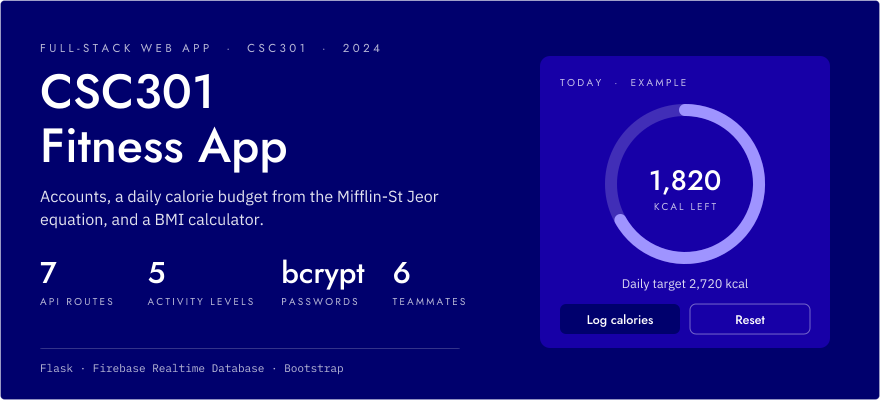
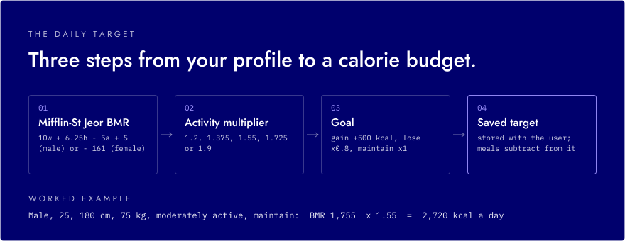
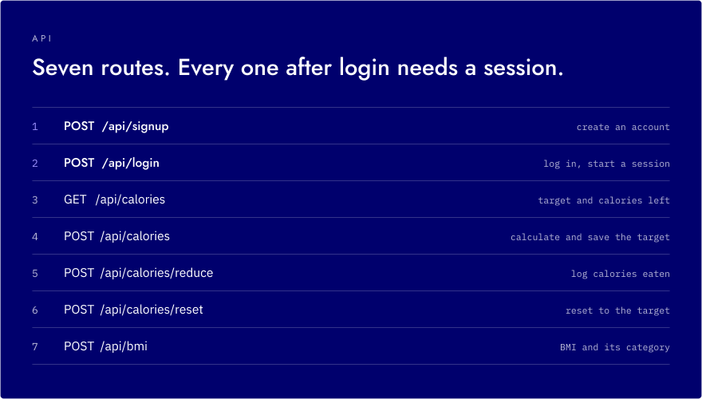
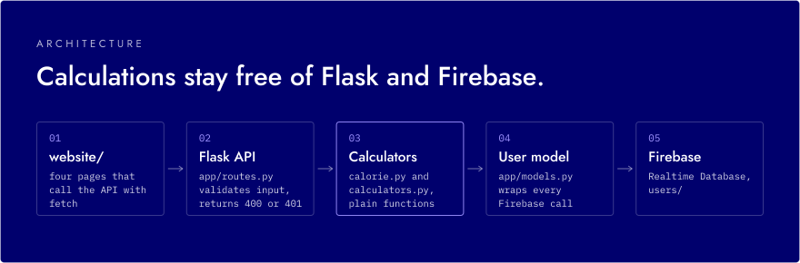

<p align="center">
  <picture>
    <source media="(prefers-color-scheme: dark)" srcset="assets/readme/hero-dark.svg">
    <source media="(prefers-color-scheme: light)" srcset="assets/readme/hero-light.svg">
    
  </picture>
</p>

<p align="center">
  <strong>A fitness web app with accounts, a daily calorie budget and a BMI calculator.</strong><br>
  <strong>Mifflin-St Jeor targets &middot; per-user calorie tracking &middot; BMI categories</strong><br>
  <sub>Flask API, Firebase Realtime Database and a Bootstrap frontend, built by a student team for CSC301.</sub>
</p>

<p align="center">
  
  
  
  
</p>

<!-- TODO: demo link or video -->

---

Users sign up, log in, and enter their age, sex, height, weight, activity level and goal. The app works out how many calories they need per day and stores that with their account. They can log calories as they eat, see what's left, and reset the count. A separate page calculates BMI and its category (underweight, healthy weight, overweight or obesity). The team split the work into tickets and user stories and merged it through pull requests.

## The daily target

<p align="center">
  <picture>
    <source media="(prefers-color-scheme: dark)" srcset="assets/readme/calories-dark.svg">
    <source media="(prefers-color-scheme: light)" srcset="assets/readme/calories-light.svg">
    
  </picture>
</p>

`app/calorie.py` computes the basal metabolic rate with the Mifflin-St Jeor equation, multiplies it by one of five activity levels (sedentary 1.2 up to extra active 1.9), then adjusts for the goal: +500 kcal to gain, 80% of maintenance to lose. The result is saved with the user, and each logged meal subtracts from what's left.

The calculation code (`calorie.py`, `calculators.py`) is plain functions with no Flask or Firebase imports. Routes validate input, call these functions and store the result.

## API

<p align="center">
  <picture>
    <source media="(prefers-color-scheme: dark)" srcset="assets/readme/api-dark.svg">
    <source media="(prefers-color-scheme: light)" srcset="assets/readme/api-light.svg">
    
  </picture>
</p>

Every route except signup and login returns 401 if no one is signed in. Server-side input checks return a specific 400 message for each missing or invalid field. Signup and login use bcrypt-hashed passwords and unique usernames, and Flask sessions let later calls know who is signed in.

## Architecture

<p align="center">
  <picture>
    <source media="(prefers-color-scheme: dark)" srcset="assets/readme/architecture-dark.svg">
    <source media="(prefers-color-scheme: light)" srcset="assets/readme/architecture-light.svg">
    
  </picture>
</p>

The static frontend in `website/` calls the Flask API with `fetch`, sending the session cookie with each request. The `User` model wraps all Firebase access: signup and login look users up with an `order_by_child("name").equal_to(...)` query, and passwords are only ever stored as bcrypt hashes. The Firebase app is created once at import time and guarded by `firebase_admin._apps`, so reloads in debug mode don't try to initialise it twice.

## Screenshots

<p align="center">
  
  
  
  
  
  
</p>

## Getting started

You need Python 3 and a Firebase project with a Realtime Database. The database URL is set in `app/__init__.py`.

1. Set up the backend:

   ```sh
   python3 -m venv .venv
   source .venv/bin/activate
   pip3 install -r requirements.txt
   ```

2. Download a service account key from the Firebase console and save it in the repo root as `csc301-fitness-app-firebase-admin-1.json`. The app loads it from the current working directory.

3. Start the API. It runs on http://127.0.0.1:5000, which is the address the frontend scripts call.

   ```sh
   python run.py
   ```

4. Serve the frontend on port 5501, the only origin the API's CORS setup allows:

   ```sh
   python3 -m http.server 5501 --bind 127.0.0.1 --directory website
   ```

   Then open http://127.0.0.1:5501/signup.html.

## Team

Built for CSC301 by Haashir Khan, Steven Wang, Mohak Varma, and GitHub users envoamr, Zandercat and Melon-Man1. <!-- verify: teammates' full names -->
