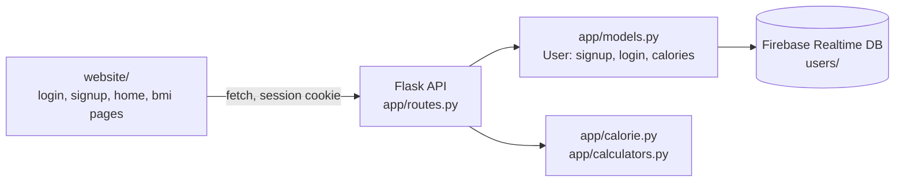

# CSC301 Fitness App

A fitness web app with accounts, a daily calorie budget based on the Mifflin-St Jeor equation, and a BMI calculator. It has a Flask API, a Firebase database and a Bootstrap frontend.


## Demo

<!-- TODO: demo link or video -->


## Overview

Users sign up, log in, and enter their age, sex, height, weight, activity level and goal. The app works out how many calories they need per day and stores that with their account. They can log calories as they eat, see what's left, and reset the count. A separate page calculates BMI and its category. The project was built by a team of students for CSC301, with work split into tickets and user stories and merged through pull requests.

## Key features

- Sign-up and login with bcrypt-hashed passwords and unique usernames, plus Flask sessions so later API calls know who is signed in.
- Daily calorie target using the Mifflin-St Jeor BMR equation, five activity multipliers (1.2 to 1.9), and a goal adjustment: +500 kcal to gain, 80% of maintenance to lose.
- Calorie tracking per user: log calories eaten, see what's left, and reset.
- BMI calculator with categories (underweight, healthy weight, overweight, obesity).
- Server-side input checks that return a specific 400 message for each missing or invalid field.

## Tech stack

| Area | Tools |
|---|---|
| Backend | Python, Flask 3, Flask-Bcrypt, Flask-CORS |
| Database | Firebase Realtime Database (`firebase-admin`) |
| Frontend | HTML, Bootstrap, vanilla JavaScript (`fetch`) |
| Tooling | pylint, Black |

## Architecture

The static frontend in `website/` calls the Flask API with `fetch`, sending the session cookie with each request. Flask handles auth and calculations and reads and writes user records in Firebase.



API routes:

| Method | Route | Purpose |
|---|---|---|
| POST | `/api/signup` | Create an account |
| POST | `/api/login` | Log in and start a session |
| GET | `/api/calories` | Daily target and calories remaining |
| POST | `/api/calories` | Calculate and save the daily target |
| POST | `/api/calories/reduce` | Log calories eaten |
| POST | `/api/calories/reset` | Reset calories remaining to the target |
| POST | `/api/bmi` | Calculate BMI |

Every route except signup and login returns 401 if no one is signed in.

## Technical highlights

- The calculation code (`calorie.py`, `calculators.py`) is plain functions with no Flask or Firebase imports. Routes validate input, call these functions and store the result.
- The `User` model wraps all Firebase access. Signup and login look users up with an `order_by_child("name").equal_to(...)` query, and passwords are only ever stored as bcrypt hashes.
- The Firebase app is created once at import time and guarded by `firebase_admin._apps`, so reloads in debug mode don't try to initialise it twice.

## Getting started

You need Python 3 and a Firebase project with a Realtime Database. The database URL is set in `app/__init__.py`.

1. Set up the backend:

   ```sh
   python3 -m venv .venv
   source .venv/bin/activate
   pip3 install -r requirements.txt
   ```

2. Download a service account key from the Firebase console and save it in the repo root as `csc301-fitness-app-firebase-admin-1.json`. The app loads it from the current working directory.

3. Start the API. It runs on http://127.0.0.1:5000, which is the address the frontend scripts call.

   ```sh
   python run.py
   ```

4. Serve the frontend on port 5501, the only origin the API's CORS setup allows:

   ```sh
   python3 -m http.server 5501 --bind 127.0.0.1 --directory website
   ```

   Then open http://127.0.0.1:5501/signup.html.

## Team

Built for CSC301 by Haashir Khan, Steven Wang, Mohak Varma, and GitHub users envoamr, Zandercat and Melon-Man1. <!-- verify: teammates' full names -->
